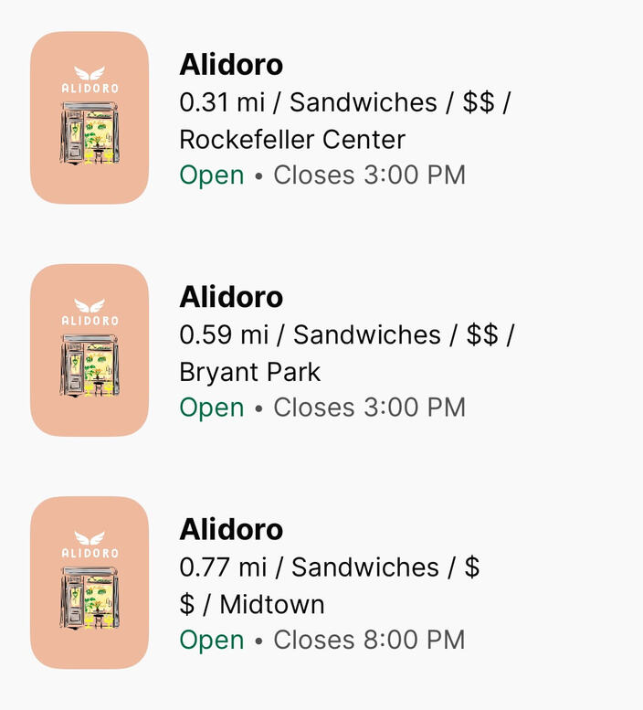
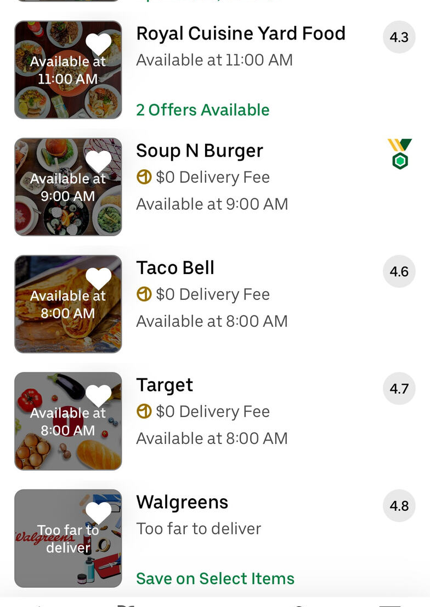
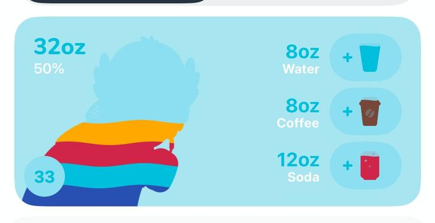
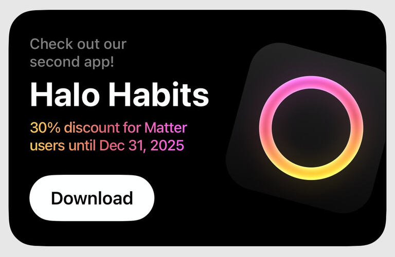
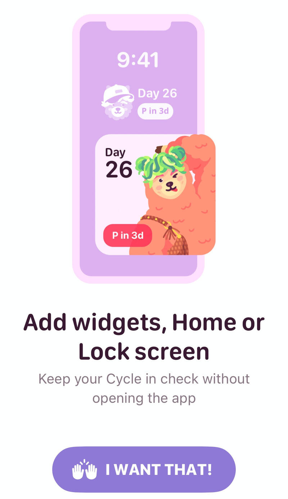
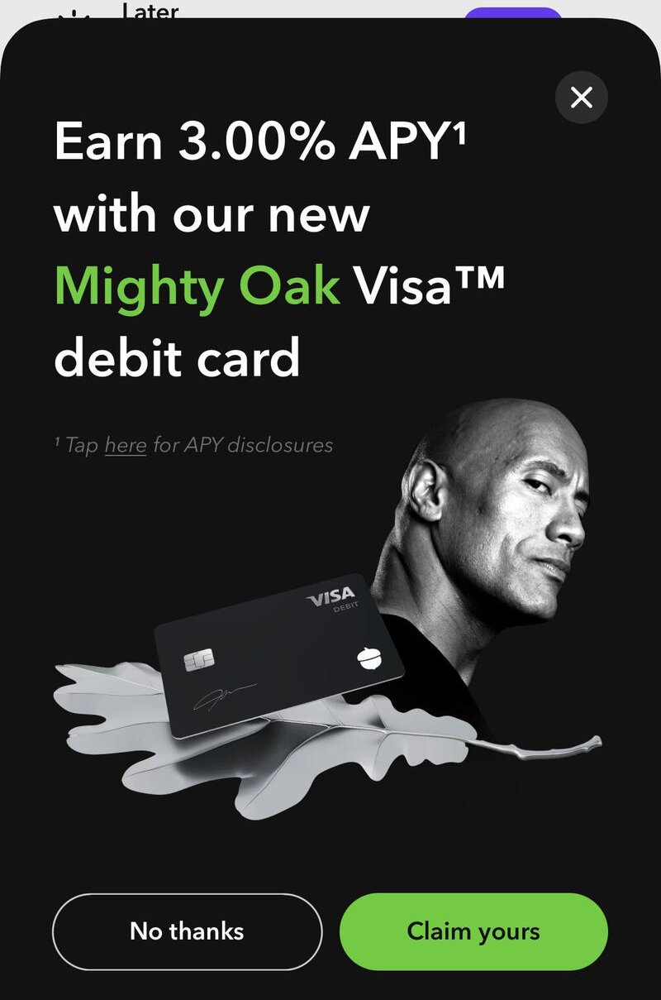

# Home-screen widget · references (ios mode, Android-first)

Direction: project tokens (`lib/features/lists/presentation/widgets/list_tokens.dart`,
brand `#344E41`). Widget text uses the launcher's system font (RemoteViews cannot load
Poppins). Researched 2026-10-16 with partwise. Refero has almost no real saved-places
widgets or inline widget upsells, so header, empty state and the 2×2 size are designed
from the row anatomy below.

## Saved cafes widget
Header (opens Saved), up to 3 Want to try cafes with name and one status line; 2×2 shows 1.
Built in `android/app/src/main/res/layout/saved_cafes_widget*.xml` and
`android/app/src/main/kotlin/app/nookph/SavedCafesWidgetProvider.kt`; data from
`lib/features/home_widget/domain/saved_cafes_widget_data.dart`.

**Primary: Blackbird.** Borrow: Uber Eats. Rejected: Waterllama.

| | Product | Taken |
|---|---|---|
|  | [Blackbird](https://refero.design/screens/387a6477-3cb3-4420-a4fe-f1fc6152c3ef) | Row = bold name, then one status line with the open state first and the time after it |
|  | [Uber Eats](https://refero.design/screens/50c30f7e-9cfb-4b26-a4c3-de8a13354db2) | Closed favourites state their next opening ("Opens 8 AM") instead of "Closed" |
|  | [Waterllama](https://refero.design/screens/b10e5589-9799-40bd-911e-ee45ea2993dc) | Considered, not taken: a metric card with action buttons, not a list |

## Add-widget promo card
One-time inline card on the Saved tab: title, one line, "Add widget" + "Not now", a small
preview of the widget with the user's own cafes. Built in
`lib/features/home_widget/presentation/widgets/home_widget_promo_card.dart`.

**Primary: Matter.** Borrow: Pinkllama, Acorns.

| | Product | Taken |
|---|---|---|
|  | [Matter](https://refero.design/screens/6b87cbbe-7d1e-4bca-85b1-246802257b02) | Inline card in the list: text and button left, illustration anchored right |
|  | [Pinkllama](https://refero.design/screens/6b75e16f-e65c-4696-904e-024b42ab0964) | The illustration is a mini preview of the actual widget |
|  | [Acorns](https://refero.design/screens/3853bd45-de60-422b-95f8-ac0ec7e2f206) | Outlined "No thanks" beside the filled primary, in one row |
